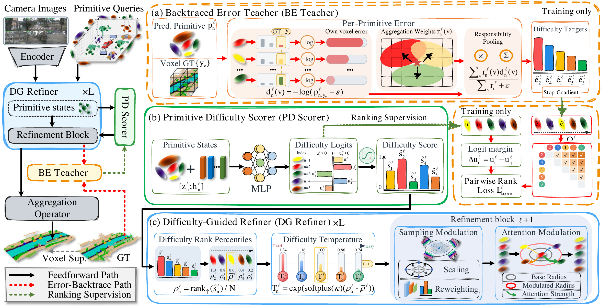

<p align="center">
  
</p>

<h1 align="center">
  Not All Primitives Are Equal:<br>
  Learning Primitive Difficulty for Object-Centric 3D Occupancy Prediction
</h1>


## Abstract

Object-centric 3D occupancy prediction aggregates compact parametric primitives into dense semantic voxel fields for autonomous driving. The quality of the aggregated field thus hinges on each primitive. However, since primitives have no ground truth of their own, existing methods supervise them only through voxel-level losses on the aggregated field, which do not explicitly measure each primitive's prediction error on its responsible occupied voxels, limiting targeted refinement. To address this, we propose Primitive-level Difficulty-aware Enhancement (PriDE), a plug-and-play scheme that makes per-primitive difficulty an explicit, learnable quantity and uses it to guide refinement. First, PriDE constructs a *Backtraced Error Teacher*, which uses aggregation responsibilities to evaluate each primitive's own prediction error on occupied voxels during training, yielding per-primitive difficulty targets at negligible cost. Since these targets require ground truth and are unavailable at inference, a *Primitive Difficulty Scorer* then learns from them via rank-based supervision to predict the difficulty of each primitive from its inference-time state. Finally, the *Difficulty-Guided Refiner* uses the predicted difficulty to redistribute refinement toward hard primitives, letting them widen their sampling and attention to gather more context. Extensive experiments on the SurroundOcc and Occ3D datasets show that PriDE consistently improves object-centric baselines.

## Method Overview



## Code Availability

This implementation is built on SuperOcc and supports inference and evaluation for PriDE-L and PriDE-M on Occ3D-nuScenes.

Training code will be released upon acceptance of the paper.

## 1. Installation

Follow `docs/install.md` (Python 3.9, PyTorch 1.13.1 + CUDA 11.7, mmcv-full
1.6.0, mmdet 2.28.2, mmsegmentation 0.30.0, mmdet3d 1.0.0rc6), then clone
`mmdetection3d` into the repository root -- the configs inherit two stock files
from it (`configs/_base_/datasets/nus-3d.py`, `configs/_base_/default_runtime.py`).

Build the CUDA extensions:

```bash
bash scripts/build_ops.sh
```

This builds four extensions:

| Package | Role |
|---|---|
| `ops/msmv_sampling` | multi-scale multi-view feature sampling |
| `ops/tile_localagg_prob_sq` | superquadric-to-voxel splatting (forward/backward) |
| `ops/tile_localagg_prob_sq_bt` | splatting + shared-CE backtrace |
| `ops/tile_localagg_prob_sq_bt2` | **PriDE**: adds the own-CE backtrace kernel of Eq.(5)-(7) |

`_bt` and `_bt2` are built in place, because the heads import `_C` from the
source tree rather than from `site-packages`.
## 2. Evaluation

Run from the repository root with the checkpoint matching the model size:

```bash
bash scripts/eval.sh l /path/to/pride-l.pth
bash scripts/eval.sh m /path/to/pride-m.pth
```

The evaluation launcher defaults to 8 GPUs. Its optional third argument sets
the number of GPUs.

## 3. Acknowledgements

This implementation builds on [SuperOcc](https://github.com/Yzichen/SuperOcc)
and [MMDetection3D](https://github.com/open-mmlab/mmdetection3d).

The CUDA splatting kernels derive from the Inria GRAPHDECO local-aggregation
code; the original license headers are preserved in `ops/*/src/`.
